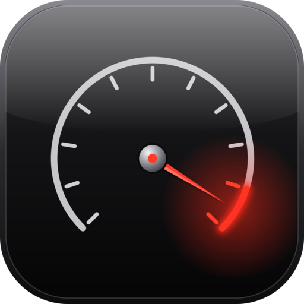

# Claude-Redline



**Claude Code usage alerts without another dashboard.**

Claude-Redline is a small Claude Code plugin that warns you when you're getting close to your 5-hour and 7-day usage limits.

There are already some great Claude Code usage monitors with status bars, dashboards, history, charts, and analytics. Redline isn't trying to replace them. It's for people who don't need all of that.

Redline stays out of the way until there's something worth knowing. It uses Claude Code's own plugin API to read your usage, so it doesn't need to read your login credentials, poll Anthropic's API, parse your transcripts, or run Claude in the background.

Install it and keep working.

When you start getting close to a limit, Redline lets you know.

## What it does

- Warns you as you approach your 5-hour and 7-day usage limits
- Lets you choose when those warnings appear
- Shows both usage windows in each notification
- Lets you check your current usage anytime with `/redline`
- Keeps `~/.claude/usage.json` current for scripts and other tools

No dashboard. No charts. No history. No transcript scanning. No OAuth token access. No API polling. No telemetry.

**Small on purpose.**

## Install

You need Claude Code and the VS Code extension at version 2.1.299 or later.

From the Claude Code marketplace:

```bash
claude plugin marketplace add timsamoff/Claude-Redline
claude plugin install redline@timsamoff-tools
```

Or load a clone of this repo for one session:

```bash
claude --plugin-dir ./claude-redline
```

## Usage

Redline works automatically once installed.

By default, it notifies you the first time either usage window crosses 70% or 90%. It always notifies you at 95%, whatever levels you choose, and that alert stays on screen longer. Each notification shows when the window resets.

Each notification shows both usage windows, as two toasts, one per window. The icon is green below 59%, yellow from 59%, and red from 89%, whatever levels you choose:

```text
🟡 5h: 72% - resets at 2:20 PM
🟢 7d: 32% - resets Thursday at 3:00 PM
```

You can turn either window's toasts off in the settings. `usage.json` is still kept current, and `/redline` shows only the windows that are on.

Redline also notifies you when a usage window resets and once if `usage.json` can't be written.

To check your usage without waiting for a notification, use:

```text
/redline
```

This shows your current 5-hour and 7-day usage and their reset times in a notification, not in the chat.

## Settings

Change Redline's settings through `/plugin` and restart Claude Code for them to take effect.

| Setting | Default | What it does |
| --- | --- | --- |
| Toast levels (percent) | 70, 90 | Usage percentages that trigger a notification. Separate them with commas, use 1 to 100, and give up to five. A notification at 95% always appears as well, so you don't need to list it. Invalid input falls back to the default |
| Toast duration (seconds) | 6 | How long regular notifications stay on screen |
| Alert toast duration (seconds) | 10 | How long 95% and write-failure notifications stay on screen |
| Show 5-hour toasts | On | Turn the 5-hour window's toast on or off |
| Show 7-day toasts | On | Turn the 7-day window's toast on or off |
| Time format | System | How reset times are shown: System (your computer's setting), 12-hour, 24-hour (both in your local time zone) or UTC |

The defaults are intended to work without any configuration. Change them only if you want Redline to get your attention earlier or later.

## What it touches

A Claude Code plugin runs with your permissions, so here's exactly what Redline does.

It registers a `/redline` command in every session. When the session is running in VS Code, it also:

- reads the rate-limit windows and context fill Claude Code already has,
- reads `HOME` or `USERPROFILE` to find your home folder,
- writes `~/.claude/usage.json`, and
- shows notifications.

It makes no network calls and starts no processes.

This is the output of:

```bash
claude plugin validate ./claude-redline
```

```text
./register.js hooks: session.start, command.run{command=redline}, session.measure, turn.complete
./register.js answers its own command: command.run{command=redline}
./register.js calls: $.command.register, $.env.get (via homeDir), $.fs.write (via writeUsage), $.session.surfaces (via handle), $.session.usage, $.ui.log, $.ui.toast (via handle, toastEach)
./register.js env writes: nothing
./register.js env reads: HOME, USERPROFILE
```

The whole plugin is one code file, [`register.js`](claude-redline/hooks/register.js), so you can read it before you install it.

See [`DESIGN.md`](DESIGN.md) for more about how it works.

## Why `usage.json`?

The Claude Code status line can write your current usage to a file, but the VS Code extension doesn't run a status line. That means the file can go stale when you're working in VS Code.

Redline keeps it current using the same format:

```json
{
  "five_hour_pct": 41,
  "seven_day_pct": 32,
  "five_hour_resets_at": "1792443000",
  "seven_day_resets_at": "1792706400",
  "context_pct": 6,
  "updated_at": 1792441730
}
```

This makes the same usage information available to scripts, automations, or anything else that needs a simple machine-readable source.

Percentages and `updated_at` are numbers. The `*_resets_at` values are epoch seconds stored as strings. A missing window uses `null` and an empty string. If neither usage window is available, Redline doesn't write the file.

## Limits

- Redline currently writes usage data only when Claude Code is running in VS Code, so it doesn't compete with a terminal status line.
- Only the 5-hour and 7-day usage windows are monitored. Other limit types are ignored.
- `usage.json` is replaced in place rather than written atomically, so another process could theoretically read it in the middle of a write.
- The Claude desktop app has not been tested.
- Rate-limit information is only available for claude.ai Pro and Max subscriptions. If Claude Code doesn't provide usage data for your account, Redline has nothing to report.

## Status

Redline is early and intentionally small.

Version **0.0.1** has been verified in live VS Code sessions with Claude Code 2.1.301. The plugin loads, receives both usage windows, keeps `usage.json` updated, and displays notifications with the correct icons.

Threshold and reset behavior has also been tested with simulated usage data. The `/redline` command and the `levels` setting are new and have not been verified in a live session yet.

If you run into something, open an issue.

## License

MIT. See [`LICENSE`](LICENSE).
